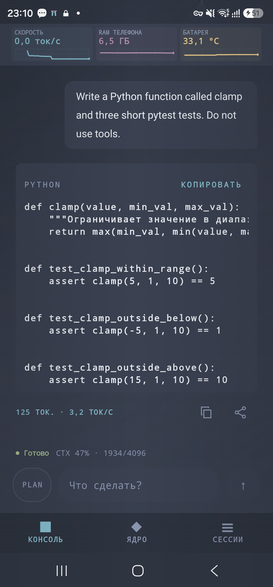
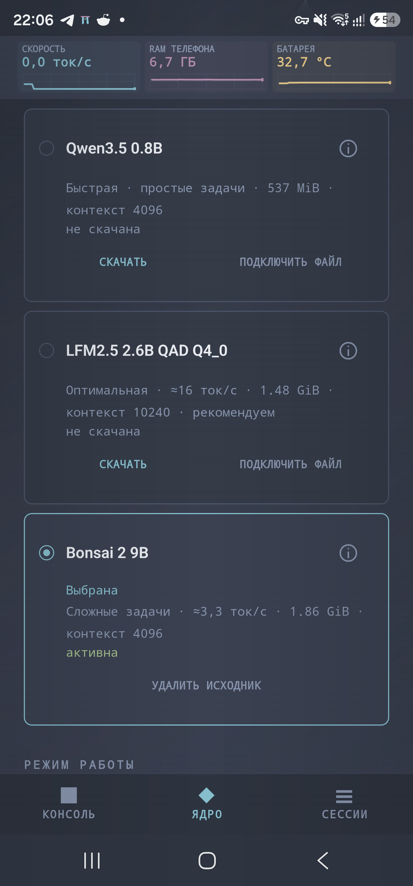
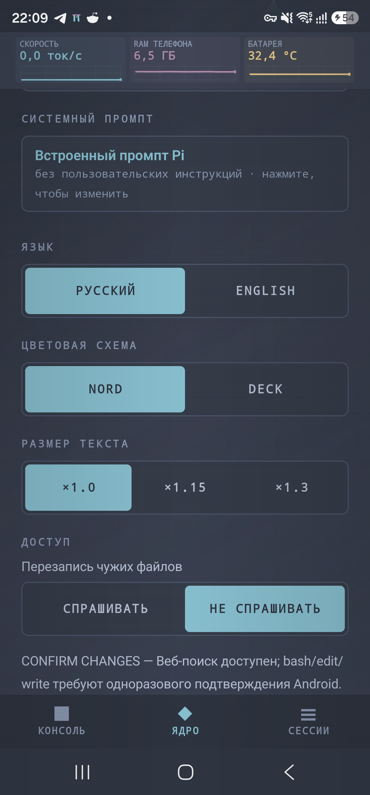

<div align="center">

# π//DECK

**A local AI coding assistant for Android**

[English](README.md) · [Русский](README.ru.md)

[](https://github.com/tigrohvost/pi-deck/actions/workflows/build.yml)
[](LICENSE)

[Latest main build](https://github.com/tigrohvost/pi-deck/actions/workflows/build.yml) · [Published releases](https://github.com/tigrohvost/pi-deck/releases)

</div>

PI//DECK runs the language model on your phone. It can explain a project, find
code, edit files and run checks through [Pi](https://github.com/earendil-works/pi)
and Termux. No cloud model or root is required.

This README describes the current `main` branch. Tagged releases may lag behind
these screenshots. To get the current APK, open a successful **build** run and
download its **pi-deck-signed-release** artifact.

## The interface

| Code response and telemetry | Three model profiles | Appearance and core settings |
|:--:|:--:|:--:|
|  |  |  |

The full-width top strip shows generation speed, **whole-phone used RAM** and
**battery temperature**. Its subdued graphs retain two minutes of history,
sampled every two seconds, including while the native core runs in the
background. `≈` marks a text-based speed estimate; an unavailable reading is
`—`. Battery temperature is not CPU temperature.

Core status and context share one row. The Stop button stays inside the
composer, including with the keyboard open. Model actions sit side by side;
the information icon opens model details. Both Russian and English interfaces
and two colour schemes are available.

## What it can do

- Chat locally, explain code and answer questions about a project.
- Search files and symbols, read relevant code and make targeted edits.
- Check syntax and run supported project tests, reporting failures and limits.
- Make a plan before acting; request access according to the chosen profile.
- Keep sessions, show tool activity, queue a prompt and stop the current task.
- Use explicit web-search and weather tools when network access is allowed.

Models can make mistakes. Tool access uses the Termux user's permissions;
local inference does **not** make tool execution an operating-system sandbox.
Web tools send network requests even though model inference remains local.
See the [security model](docs/security-model.md).

## Three models

| Role | Model / quantization | Weight file | Evidence and trade-off |
| --- | --- | ---: | --- |
| Fast, simple tasks | Qwen3.5 0.8B Q4_0 | 537 MiB | Small profile for short answers and limited memory |
| Recommended balance | LFM2.5 2.6B QAD Q4_0 | 1.49 GiB | Around 16 tok/s in earlier SM-S918B tests; reading, editing and tests checked |
| Larger, slower option | Bonsai 2 9B PTQ1_0 | 1.86 GiB | Around 3.3 tok/s with a fan; exact output, navigation and a small repair checked |

The app recommends LFM2.5 when RAM and storage allow it, otherwise Qwen 0.8B.
Bonsai is selected manually. More parameters do not guarantee a better answer
on every task. These are text-only profiles; their `EXPERIMENTAL`/`CANDIDATE`
labels remain because the full 28-task admission suite has not been completed.

A model card shows RAM requirements, installation space and the source.
Download a model or attach an existing GGUF with the expected name; the app
checks its SHA-256 and installs a private copy. Storage must accommodate both
copies. Removing other profiles from the catalog does not delete their weights.

[November measurements and new-model research](docs/audit-2026-11-15.md) include
LFM3, Spark and the search for local Qwen4 weights. Experimental research
runtimes are not shipped as replacements for the app's pinned runtime.

## How it works

1. **Android app:** interface, permissions and model management. Inference runs
   in its foreground service with pinned llama.cpp or the Bonsai Prism runtime.
2. **Termux:** Pi, Python, shell tools, workspace and sessions.
3. **Local bridge:** authenticated HTTP on `127.0.0.1` connects the two sides.
   GGUF weights stay in app-private storage after verification.

Prompt caching, CPU affinity and separate generation/prefill thread settings
reduce repeated work. Bonsai 9B uses microbatch 256: a controlled SM-S918B
comparison improved prompt-processing throughput by about 9%, with unchanged
generation speed. Results depend on the device, context and temperature.

## Getting started

Requires Android 8+ (API 26), arm64, [Termux from F-Droid](https://f-droid.org/packages/com.termux/)
and enough RAM/storage for the chosen model. The current test device is a
Samsung SM-S918B with 12 GB RAM and Android 16.

1. Install Termux and PI//DECK. Grant the requested Termux command permission.
2. Use **Copy + open** in setup, paste the generated command into Termux and
   run it to enable the connection and shared storage.
3. Tap **Install core**. The app installs the pinned Pi runtime and tools;
   the existing workspace `AGENTS.md` is preserved.
4. In **Core**, download a model or attach its GGUF, then verify/install it.
5. Send a prompt. If the model is cold, the app starts it and queues the prompt.

Choose **Agent** for tools or **Chat** for direct answers. Core settings also
control access, text size, theme, autostart and idle shutdown. See
[signing and upgrade guidance](docs/release-process.md) when changing APK sources.

## Development and validation

JDK 21 is required. Native binaries are reproduced from pinned sources with
`tools/vendor_llama_android.sh` (NDK 27.1 for stock, 28.2 for sidecars; CMake
3.22.1). They are not committed to Git.

```sh
./gradlew testDebugUnitTest lintDebug assembleDebug assembleRelease
PYTHONDONTWRITEBYTECODE=1 python3 -m unittest discover -s tests/runtime
PYTHONDONTWRITEBYTECODE=1 python3 -m unittest discover -s tests/tools
python3 tools/validate_benchmark.py
```

The November audit includes 248 JVM tests, 153 runtime tests, 79 tooling tests,
phone UI/lifecycle checks, real agent prompts and inference measurements.
The build validates every native file's size, SHA-256 and 16 KB ELF alignment.
GitHub Actions builds signed APKs on `main`; tags publish releases. Native
builds are cached by their source/manifest inputs and revalidated on cache hits.

[Audit and limits](docs/audit-2026-11-15.md) · [Changelog](CHANGELOG.md) ·
[Architecture](docs/architecture.md) · [Model admission](docs/model-admission.md) ·
[Release process](docs/release-process.md)

## License

[MIT](LICENSE). Model weights have their own licenses, linked from their cards.
