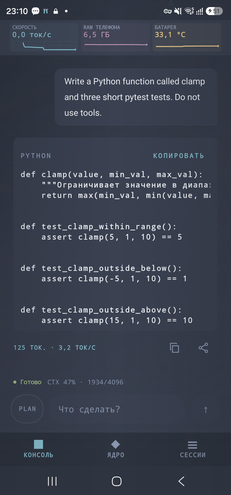
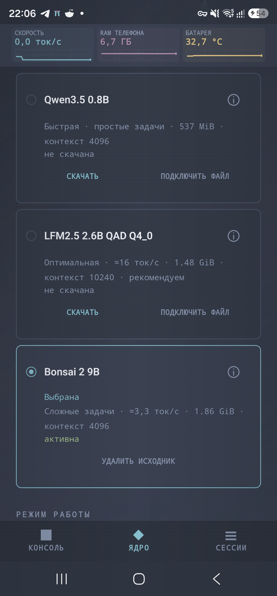
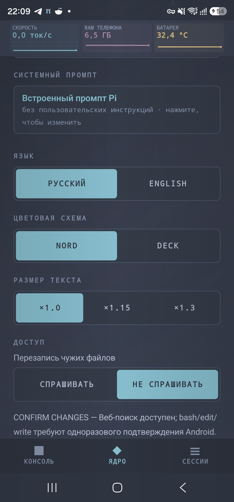

<div align="center">

# π//DECK

**Локальный ИИ-помощник для работы с кодом на Android**

[English](README.md) · [Русский](README.ru.md)

[](https://github.com/tigrohvost/pi-deck/actions/workflows/build.yml)
[](LICENSE)

[Скачать подписанный APK (0.3.0-alpha20)](https://github.com/tigrohvost/pi-deck/releases/download/v0.3.0-alpha20/pi-deck.apk) · [Опубликованные релизы](https://github.com/tigrohvost/pi-deck/releases)

</div>

PI//DECK запускает языковую модель на телефоне. Помощник может объяснить
проект, найти код, изменить файлы и запустить проверки через
[Pi](https://github.com/earendil-works/pi) и Termux. Облачная модель и root
не требуются.

## Интерфейс

| Ответ модели и графики | Три профиля моделей | Оформление и настройки ядра |
|:--:|:--:|:--:|
|  |  |  |

Верхняя панель на всю ширину показывает скорость генерации, **занятую RAM
всего телефона** и **температуру батареи**. Приглушённые графики хранят две
минуты истории с шагом две секунды, в том числе в фоне, пока работает служба
ядра. `≈` обозначает оценку скорости по тексту, `—` — отсутствие показания.
Температура батареи не выдаётся за температуру процессора.

Статус ядра и контекст объединены в одну строку. Кнопка «Стоп» не обрезается,
в том числе при открытой клавиатуре. Действия моделей расположены рядом,
значок информации открывает подробности. Доступны русский и английский
интерфейс, две цветовые схемы и настройка размера текста.

## Что умеет

- Отвечать локально, объяснять код и помогать разобраться в проекте.
- Искать файлы и определения, читать нужный код и вносить точечные правки.
- Проверять синтаксис и запускать поддерживаемые тесты, сообщая об ошибках
  и ограничениях проверки.
- Составлять план перед работой и запрашивать доступ согласно выбранному профилю.
- Сохранять сессии, показывать работу инструментов, ставить запрос в очередь
  и останавливать текущую задачу.
- Использовать явные инструменты веб-поиска и погоды, если разрешена сеть.

Модель может ошибаться. Инструменты работают с правами пользователя Termux;
локальный инференс **не создаёт песочницу ОС**. Веб-инструменты обращаются
к сети, хотя сама модель работает на устройстве. Подробнее —
[модель безопасности](docs/security-model.md).

## Три модели

| Роль | Модель / квантование | Файл весов | Проверки и компромисс |
| --- | --- | ---: | --- |
| Быстрая, простые задачи | Qwen3.5 0.8B Q4_0 | 537 MiB | Небольшой профиль для коротких ответов и ограниченной памяти |
| Рекомендуемый баланс | LFM2.5 2.6B QAD Q4_0 | 1,49 GiB | Около 16 ток/с в прежних замерах на SM-S918B; проверены чтение, правка и тесты |
| Крупнее, но медленнее | Bonsai 2 9B PTQ1_0 | 1,86 GiB | Около 3,3 ток/с с вентилятором; проверены точный ответ, поиск по коду и небольшая правка |

При достаточных RAM и месте приложение рекомендует LFM2.5, иначе — Qwen
0.8B. Bonsai выбирается вручную. Большее число параметров не гарантирует
лучший ответ на любую задачу. Это текстовые профили; статусы
`EXPERIMENTAL`/`CANDIDATE` сохранены: полный агентный набор из 28 задач
ещё не пройден.

Карточка показывает требования к RAM, место для установки и источник.
Модель можно скачать или подключить готовый GGUF с ожидаемым именем.
Приложение проверяет SHA-256 и создаёт приватную копию; место требуется
для обеих копий. Исключение других профилей из списка не удаляет их веса.

[Ноябрьский отчёт](docs/audit-2026-11-15.md) содержит замеры, проверки LFM3
и Spark, а также результаты поиска локальных весов Qwen4. Исследовательские
движки не подменяют закреплённый движок приложения.

## Как работает

1. **Android-приложение:** интерфейс, разрешения и модели. Инференс выполняется
   в foreground-службе с закреплённым llama.cpp или Prism для Bonsai.
2. **Termux:** Pi, Python, shell-инструменты, рабочая папка и сессии.
3. **Локальный мост:** аутентифицированный HTTP на `127.0.0.1` связывает
   компоненты. Проверенные GGUF находятся в приватном хранилище приложения.

Кэш промпта, привязка CPU и отдельные настройки потоков для генерации и
подготовки подсказки сокращают повторную работу. Для Bonsai 9B microbatch 256
в контрольном сравнении на SM-S918B повысил скорость подготовки примерно
на 9%; скорость генерации не изменилась. Результат зависит от телефона,
контекста и нагрева.

## Как начать

Нужны Android 8+ (API 26), arm64,
[Termux из F-Droid](https://f-droid.org/packages/com.termux/), достаточно RAM
и места для выбранной модели. Текущий тестовый телефон — Samsung SM-S918B,
12 ГБ RAM, Android 16.

1. Установите Termux и PI//DECK. Разрешите запрошенный доступ к командам Termux.
2. В настройке подключения нажмите **«Копировать + открыть»**, вставьте
   подготовленную команду в Termux и выполните её.
3. Нажмите **«Установить ядро»**. Приложение установит закреплённые Pi и
   инструменты; существующий `AGENTS.md` рабочей папки сохранится.
4. В **«Ядро»** скачайте модель или подключите GGUF, затем проверьте/установите его.
5. Отправьте запрос. Если модель ещё не загружена, приложение запустит её
   и отправит запрос из очереди.

Режим **«Агент»** включает инструменты, **«Чат»** предназначен для прямых
ответов. В «Ядре» также настраиваются доступ, размер текста, тема, автозапуск
и таймаут простоя. При смене источника APK смотрите
[подпись и обновление](docs/release-process.md).

## Разработка и проверки

Нужен JDK 21. Нативные файлы воспроизводятся из закреплённых исходников
скриптом `tools/vendor_llama_android.sh`: NDK 27.1 для основного движка,
28.2 для sidecar-движков, CMake 3.22.1. В Git бинарники не хранятся.

```sh
./gradlew testDebugUnitTest lintDebug assembleDebug assembleRelease
PYTHONDONTWRITEBYTECODE=1 python3 -m unittest discover -s tests/runtime
PYTHONDONTWRITEBYTECODE=1 python3 -m unittest discover -s tests/tools
python3 tools/validate_benchmark.py
```

Ноябрьская проверка включает 248 JVM-тестов, 153 runtime-теста, 79 тестов
утилит, интерфейс и жизненный цикл на телефоне, реальные запросы агенту и
замеры инференса. Сборка проверяет размер, SHA-256 и ELF-выравнивание 16 КБ
всех нативных файлов. GitHub Actions собирает подписанный APK при изменении
`main`; теги публикуют релизы. Кэш нативной сборки зависит от исходников и
манифеста; его содержимое каждый раз проверяется.

[Отчёт и ограничения](docs/audit-2026-11-15.md) · [Изменения](CHANGELOG.md) ·
[Архитектура](docs/architecture.md) · [Допуск моделей](docs/model-admission.md) ·
[Процесс релиза](docs/release-process.md)

## Лицензия

[MIT](LICENSE). Веса моделей распространяются по отдельным лицензиям,
ссылки доступны в карточках.
