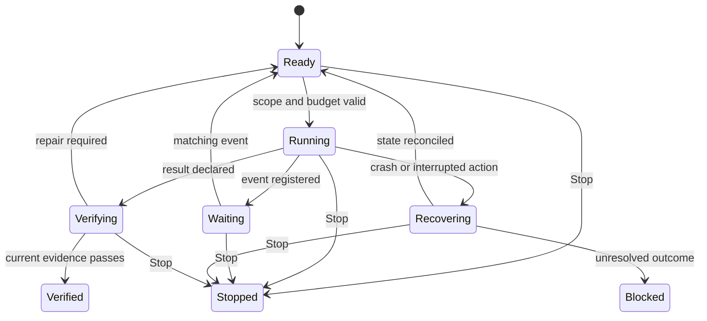

# Спецификация исследования длительных агентских задач
## Применимость открытых harness к PI//DECK и Рейн

**Идентификатор:** HARNESS-LONGRUN-2026-10-19  
**Версия:** 1.0  
**Дата среза:** 19 октября 2026 года, UTC. Commit SHA фиксировались в ходе исследования.  
**Статус:** исследование первичных источников завершено; экспериментальный протокол подготовлен к исполнению.  
**Формат решения:** перенос проверенных механизмов, отдельные испытания зависимостей и воспроизводимые решения о применимости.

### Назначение документа

Определить, какие механизмы ведущих открытых agent harness повышают вероятность доведения длительной задачи до проверенного результата, и задать программу проверки их применимости:

1. К **PI//DECK** — кодинговому агенту с Android UI, Pi в Termux и локальным inference.
2. К **Рейн** — постоянно существующему агенту с памятью и идентичностью, MicroPlan, внешними действиями, самоизменением и перезапусками.

Документ содержит результаты чтения исходников и документации, ограничения найденных гарантий, целевые контракты, программу экспериментов, метрики и критерии принятия решений. Запуски сравниваемых harness, многосуточные испытания, измерения RAM и платные вызовы моделей в рамках этой работы **не проводились**. Прочитанные upstream-тесты не выдаются за выполненные нами тесты.

**Предварительное решение.** Для PI//DECK первыми исследовать Pi durable, Codex Goals и восстановление OpenCode V2. Для Рейн — completion contracts и lifecycle Hermes, восстановление и владение OpenClaw, точную семантику replay LangGraph. Deep Agents, Gemini CLI, Cline, Goose и DeepSeek Harness дают отдельные полезные механизмы контекста, проверки, событий и фоновой работы. Это приоритет исследования, а не доказанный рейтинг успешности.

---

## 1. Исследовательский вопрос и границы

### 1.1. Что считать harness

В этой работе harness — окружающий модель исполнительный контур: инструменты, рабочее окружение, цикл вызовов, контекст, сохранение и восстановление, ограничения, проверка результата и интерфейс взаимодействия с пользователем.

Различаются четыре слоя:

| Слой | Ответственность | Пример в выборке |
|---|---|---|
| Coding harness | Читать и менять код, запускать инструменты, управлять разговором и патчем | Pi, Codex, OpenCode, Gemini CLI, Cline |
| Workflow runtime | Сохранять состояние шагов, ожидания, checkpoints и возобновлять исполнение | LangGraph, Pi durable |
| Длительно работающий ассистент | Принимать события, владеть работой, планировать пробуждение, согласовывать доставку | Hermes, OpenClaw |
| Память и идентичность | Хранить знания, происхождение сведений, правила и устойчивое описание агента | Существующие BIBLE/agent-memory Рейн; отдельный дополнительный трек Letta |

Один продукт может покрывать несколько слоёв. Наличие памяти не доказывает надёжность исполнения; workflow checkpoint не доказывает правильность кода.

Термины далее: **durable** — состояние переживает явно указанный тип сбоя; **replay** — повтор исполнения; **receipt** — сохранённое подтверждение конкретного действия; **reconciliation** — сверка его фактического результата; **admission** — допуск следующего вызова к запуску; **fencing** — проверяемый запрет действий прежнего владельца; **evidence** — проверяемые основания для принятия результата. Эти понятия не предполагают конкретную БД или framework.

### 1.2. Что означает «длительная задача»

Для испытаний длительность задаётся несколькими осями:

- **Календарное время:** минуты, часы, сутки, включая ожидание.
- **Активная работа:** число шагов модели, вызовов инструментов, затраты и время inference.
- **Контекст:** число переполнений и сжатий истории.
- **Разрывы исполнения:** restart процесса, отключение устройства, смена модели, обновление кода.
- **Изменение задачи:** уточнения пользователя, отмена, новые сведения.
- **Внешние эффекты:** действия, результат которых существует за пределами журнала агента.

Исследуемая способность — достигать актуальной цели при этих разрывах, сохраняя требования, бюджет, проверяемый результат и управляемость. Агент, который оставался запущенным сутки, ещё не продемонстрировал эту способность.

METR определяет свой time horizon через человеческую длительность задач, решаемых моделью с определённой вероятностью; наиболее известная оценка относится к 50% успеха. Это не гарантированное время самостоятельной работы процесса. В отчётах следует указывать, какой именно горизонт измерен. [E-4]

### 1.3. Основные вопросы

**RQ1.** Какие состояния должны жить вне сжатого диалога, чтобы агент сохранял цель и правильно продолжал работу?

**RQ2.** Как harness восстанавливается, если инструмент уже изменил внешний мир, а его результат ещё не записан?

**RQ3.** Какие механизмы уменьшают ложное завершение, повтор работы, зацикливание и дрейф требований?

**RQ4.** Когда улучшения контекста, проверки и делегирования окупаются на конкретной локальной модели и на модели Рейн?

**RQ5.** Можно ли перенести механизм в существующие Plan Ledger и MicroPlan без второго источника состояния задач?

**RQ6.** Как сохранить корректность при самообновлении Рейн, отмене задачи, смене владельца и восстановлении после сбоя?

### 1.4. Уровни доказательности

| Метка | Что означает | Допустимый вывод |
|---|---|---|
| CODE | Прочитан конкретный путь исходника на закреплённом SHA | Реализация содержит данный механизм и данное ограничение |
| DOC | Найдена официальная документация | Авторы документируют такое поведение |
| REPORT | Авторы публикуют результат своего benchmark | Результат относится к указанным модели, задачам, версии и протоколу |
| HYPOTHESIS | Выведено возможное поведение или предложен перенос | Требуется эксперимент; это не подтверждённый инцидент |
| MEASURED | Получено собственное воспроизводимое измерение | В этой версии спецификации таких результатов нет |

Ни CODE, ни DOC не заменяют fault injection и end-to-end проверку. Если документация и код расходятся, в карточке указывается проверенный код и условия конфигурации.

---

## 2. Исходное состояние целевых систем

### 2.1. PI//DECK: использовать актуальную базу

Проверен публичный репозиторий tigrohvost/pi-deck на SHA **da30806666c5d6c18943b37960e84ceb13023138**. Текущие документы указывают Pi **0.82.1**. Более ранние проектные обзоры не используются как описание отсутствующих сегодня возможностей. [T-1] [T-2]

В текущем Plan Ledger уже существуют состояния **done_unverified** и **verified**. Объявление DONE само по себе не является доказательством. Host связывает evidence с заявленным путём и текущим workspace snapshot; при восстановлении сохранённые verified переоцениваются. Активная фаза после reload не должна незаметно продолжать исполнение. Существуют ограниченный план, read-only проход, переход к Execute, checkpoints и журнал операций. [T-3]

Следовательно, задача исследования — проверить и расширить этот контракт на более длинную работу, а не добавить ещё один todo-файл или повторно изобрести verified state.

Свежая проектная запись измерений показывает большую чувствительность локального inference к холодному prefill и повторному использованию контекста. Там же отмечены одиночные прогоны и отдельно нерешённый вопрос качества модели. Эти цифры являются измерениями автора проекта, не нашей репликацией. В исследовании cache reuse, thermal state и корректность решения должны измеряться раздельно. [T-4]

### 2.2. Рейн: сначала сопоставить с фактическим runtime

Рабочая база из предыдущего проектного контекста: Python/Linux, один VPS порядка **2 vCPU / 4 GB**, MicroPlan с cursor/checkpoints/evidence/stop boundaries, BIBLE и отдельная память, git/self-rewrite/restart, Telegram и локальный UI.

**Текущий исходник ядра Рейн в этой работе не проаудирован.** Это исходные сведения для R0, а не утверждение о нынешних дефектах или гарантированно отсутствующих механизмах. Перед изменением необходимо найти фактические реализации MicroPlan, stores, supervisor, effects, budget и memory receipts.

Предварительные ограничения применимости:

- MicroPlan остаётся единственным источником состояния задачи.
- Одна наружу действующая Рейн; оставшиеся tool-процессы также учитываются как потенциальные исполнители.
- BIBLE, происхождение памяти, ревизии и явные решения не заменяются lossy summary.
- Явный Stop и отзыв полномочий переживают restart.
- Самообновление не должно стирать историю действий, отмен и расходов.
- Географический резерв — отдельный трек после локального lifecycle. Из этой спецификации не следует необходимость немедленно ставить кластер, etcd или второй scheduler.

Исторические оценки стоимости инфраструктуры и токенов не принимаются за текущий разрешённый бюджет экспериментов.

---

## 3. Корпус и предварительный выбор доноров

Выборка охватывает 13 основных открытых репозиториев: заметные coding harness, runtime восстановления, постоянно работающие ассистенты и минимальный контрольный агент. Отбор основан на известности, активности и разнообразии механизмов; число GitHub stars не используется как оценка надёжности.

Закрытые реализации, включая внутренний runtime облачных продуктов, не считаются открытыми только из-за наличия публичного CLI, SDK или демонстрационного примера. Публикации Anthropic используются как источник паттернов и методики. Открытый пример не равен открытому полному Claude Code harness. [E-1]

| Репозиторий | Что подтверждено для длительной работы | Существенная граница | Приоритет применения |
|---|---|---|---|
| **Pi / earendil-works/pi** | Experimental durable tasks, inbox, waits, checkpoints; политика replay инструментов | Один процесс на store; внешние эффекты требуют своего reconciliation | PI//DECK: первый кандидат отдельного spike |
| **openai/codex** | Сохраняемая Goal, восстановление, управляемое продолжение с условиями остановки, расход дерева агентов | Completion не является независимым proof gate; budget boundary мягкая | Оба: Goal/Run, прекращение продолжения, расходы |
| **anomalyco/opencode V2** | Durable claims, сохранённый счётчик recovery, связь parent/child | At-least-once; предыдущий владелец должен быть мёртв | Оба: локальное восстановление |
| **NousResearch/hermes-agent** | Goals, shell gates, task/run lifecycle, waits, worktrees | Single host; разные подсистемы имеют разные гарантии доставки | Рейн: completion contract и MicroPlan lifecycle |
| **openclaw/openclaw** | Restart recovery, execution/delivery reconciliation, singleton, watchdog | Один mutable state root не решает geo split brain | Рейн: владение, Stop, неизвестный результат |
| **langchain-ai/langgraph** | Checkpoints, pending writes, interrupt/resume, durability modes | Повтор узла может повторить внешний эффект | Оба: точный контракт шагов и replay |
| **langchain-ai/deepagents** | Offload, compaction, subagents, optional planning/verification middleware | Persistence требует конфигурации; context isolation не равно sandbox | Оба: контекст и ограниченные проверки |
| **OpenHands/software-agent-sdk** | Events, conversation persistence, stuck detection, children, leases | Defaults и outer controllers не дают полной durable mission | Coding executor и жизненный цикл дочерней работы |
| **deepseek-ai/deepseek-harness** | Plugin seams, goal CAS/revisions, compaction lifecycle, jobs API | jobs-local живёт в RAM; session resume не включает goal автоматически | Контракты расширений, фоновые jobs и контекст |
| **google-gemini/gemini-cli** | Persistent task DAG, summary probe, loop detection | Tracker experimental/session-scoped; closed не требует evidence | Облегчённые диагностика и compaction quality gate |
| **cline/cline** | SDK, durable event policy, bounded loop detector | Очередь persistence при длительном отказе может терять события | Разделение состояния и телеметрии |
| **aaif-goose/goose** | Recipes, checks, bounded retries, session resume | Загрузка расписания не равна восстановлению попытки | Проверяемые рецепты отдельных этапов |
| **SWE-agent/mini-swe-agent** | Простой воспроизводимый coding loop, явные лимиты и trajectory | Минимальная loop-архитектура без полного durable lifecycle | Контроль сложности и model/harness эффекта |

Ссылки на закреплённые реализации приведены в карточках ниже и реестре раздела 12.

**Дополнительный обзор:** Letta Code полезен для отдельного опыта с MemFS и памятью; имеются local backend paths, поэтому описание «только облачный клиент» было бы неверным. В этой работе его сквозное recovery исследовано недостаточно для рекомендации как основы Рейн. Aider учтён как известный coding reference, но не включён в подробный fault-recovery аудит. OpenHands/OpenHands проверен для понимания разделения UI и SDK; отдельный OpenHands/automation не проходил полный аудит. [L-1] [L-2] [O-1]

---

## 4. Что показало чтение исходников

### 4.1. Pi: наиболее близкий к PI//DECK путь, с экспериментальной зависимостью

Новый пакет durable хранит conversations/tasks/documents, состояние фаз, входящие события и ожидания. Повтор submit можно дедуплицировать по requestId; после восстановления фаза может выполняться с начала, поэтому границы фаз имеют значение. Есть парковка crash loop с ограничением повторов. API прямо обозначен experimental. [PI-1]

Ключевой механизм находится в обработке инструментов: аргументы и политика replay записываются **до execute**. По умолчанию replay unsafe. Автоматический повтор разрешён, только если и сохранённая политика, и текущее определение инструмента разрешают safe replay. Иначе возвращается interrupted с имеющимся частичным результатом. Прочитаны соответствующие recovery-тесты; они не запускались. [PI-2] [PI-3]

Это хороший образец для случая «старый вызов мог уже выполнить действие». Он не мешает модели самой предложить новый повтор: отдельный effect ledger и проверка результата всё равно нужны.

SQLite backend использует WAL и synchronous=NORMAL; эта настройка и single-process store не дают одинаковых гарантий при process crash, потере питания и двух писателях. JSONL store удерживает историю в памяти и поэтому требует отдельной оценки роста. [PI-1] [PI-4]

**Решение для исследования:** проверить durable package в отдельной ветке и адаптере к текущему Plan Ledger. Не считать его присутствие в upstream подтверждением совместимости с Pi 0.82.1, Android/Termux и сегодняшним протоколом PI//DECK. В Рейн можно перенести семантику intent/replay без переноса TypeScript runtime.

### 4.2. Codex: цель переживает разговор, расходы требуют точной интерпретации

Goal extension хранит objective/status/token budget/usage в базе отдельно от текста диалога. Runtime восстанавливает цель, продолжает idle turn и прекращает продолжение при terminal errors, ограничениях и повторных неудачах. Создание Goal связано с явным запросом и доступной capability; обычный prompt не обязательно становится автономной миссией. [CX-1] [CX-2]

Тесты покрывают расход child/grandchild в бюджете корневой цели, в том числе после выгрузки промежуточного runtime. При этом начисление может продолжаться до остановки текущего turn после перехода в budget_limited. Это мягкая граница, полезная для остановки, но не строгий денежный admission каждого запроса. [CX-3]

Goal complete остаётся решением в рабочем процессе агента. Для исследуемой проверяемой приёмки нужен отдельный evaluator. Локальный writer lock защищает thread в одном Codex home, а не независимые VPS. [CX-2] [CX-4]

**Протокол сравнения:** текущий Codex допускает custom providers, однако WireApi содержит Responses; произвольный Chat Completions endpoint напрямую не подходит. Bridge между API необходимо учитывать отдельной переменной, предварительно проверив tools, events, usage и resume. [CX-5]

### 4.3. OpenCode V2: явно описанная at-least-once recovery

В session store сохраняется claim незавершённого выполнения. После старта managed server recovery находит оставшиеся claims. Счётчик resume записывается до попытки; предел по умолчанию — 10 восстановлений одного turn. Завершение и освобождение claim согласованы через commit. [OC-1] [OC-2]

Исходник прямо ограничивает гарантию: recovery at-least-once, прежний владелец должен быть мёртв. Это не exactly-once внешнего действия. Незавершённый background shell после restart получает cancelled; уже сохранённые completed/error сохраняют свой исход. Дочерняя session восстанавливается через сохранённую связь с родителем. [OC-1] [OC-3]

Compaction формирует структурированное резюме требований, решений и состояния работы, сохраняя recent tail. Документация V2 прямо называет compaction lossy. Резюме — удобный контекст следующего шага, но не единственный реестр обязательств. [OC-4]

**Применимость:** durable retry counter, interrupted/cancelled states, inbox и recovery children. Для Рейн переносить контракт в MicroPlan; для PI//DECK сравнить с адаптацией Pi durable. Не смешивать V2 packages/core с прежними обзорами V1.

### 4.4. Hermes: отдельно оценивать Goals, Kanban и доставку

Goal contract содержит outcome, verification, constraints, boundaries, stop_when. В upstream эти поля допускаются как необязательные; в нашем протоколе критические acceptance criteria должны быть обязательны. Shell quality gates выполняются до LLM judge; возможны done/blocked/continue/wait. Ожидание может парковать цикл. Resume сбрасывает turn counter, поэтому этот счётчик не заменяет общий сохраняемый бюджет миссии. [HM-1]

Kanban использует SQLite task/run/events, атомарный claim и expected_run_id при завершении. Есть handoff/evidence и проверки текущего PR SHA для acceptance. Reclaim учитывает состояние worker; потенциально живой старый исполнитель не должен уступать claim новому. Это сильный донор локального lifecycle. [HM-2] [HM-3] [HM-7]

Гарантии доставки неодинаковы. Cron queue после прерванной попытки отправки помечает результат unknown и не повторяет его автоматически: возможна потеря доставки при предотвращении повторной попытки. Kanban notify+wake имеет собственное crash-окно и не наследует эту гарантию. [HM-4] [HM-5]

**Применимость:** расширить существующий MicroPlan необходимыми полями и правилами завершения. Не создавать параллельную Kanban-плоскость только ради повторения upstream архитектуры. Parent и children имеют отдельные in-memory iteration caps; агрегированный durable budget надо исследовать отдельно. [HM-6]

### 4.5. OpenClaw: восстановление результата и управление владельцем

Документированный restart recovery различает допустимое продолжение принятой работы и терминальный Stop/cancel. Сохранённый итог выполнения и результат доставки — отдельные состояния. Cron reconciliation сопоставляет точные run/store/receipt identities, а не только близкое время. При неизвестной доставке система не обязана повторять исходный payload. [CL-1] [CL-2] [CL-5]

Gateway lock учитывает владельца процесса; живого владельца нельзя вытеснить лишь по возрасту lock. Watchdog отделяет наблюдаемую активность от полезного продвижения. Эти механизмы важны при зависшем worker и попытке замены. [CL-3] [CL-4]

**Применимость:** терминальность Stop, точные receipts, различение execution/delivery, проверка прежнего writer перед передачей работы. Gateway singleton относится к одному state root. Две VPS с копиями базы и одинаковыми credentials требуют отдельной схемы владения внешними действиями.

### 4.6. LangGraph: сильные checkpoints с явной границей внешнего мира

LangGraph сохраняет состояние supersteps и pending writes успешных соседних узлов. Persistent saver и стабильный thread_id должны быть заданы явно. Режимы различаются: sync фиксирует checkpoint перед следующим шагом, async оставляет окно последней записи, exit не обеспечивает восстановление промежуточного состояния при падении в ходе работы. [LG-1]

После interrupt узел начинается заново; код до точки interrupt может повториться. Эту границу необходимо учитывать при выборе того, какие действия помещать в узел. [LG-2]

**Следствие для проектирования:** даже sync checkpoint не является атомарной транзакцией с Telegram, git remote или другим сервисом. Он не восстанавливает filesystem и процессы. Требуются классификация повторов и reconciliation. Это вывод о границах модели исполнения, а не утверждение об ошибке LangGraph.

### 4.7. Deep Agents: полезный контекст, меняющиеся defaults

На исследованной версии 0.7.28 planning/TodoListMiddleware уже opt-in. Нельзя переносить старое представление «Deep Agents всегда добавляет todos» и нельзя выводить отсюда, что слабой локальной модели план больше не нужен. create_deep_agent принимает checkpointer=None; StateBackend без persistent saver не создаёт автоматически crash persistence. [DA-1] [DA-2]

Offload и summarization сокращают активный контекст; история может архивироваться. В прочитанном summarization.py ошибка offload логируется, но summarization продолжается. Для критических обязательств Рейн надо проверить более строгий контракт сохранности. Fallback порога при неизвестном model profile также нельзя копировать на малое локальное окно. [DA-3]

Изолированный subagent context не равен отдельному filesystem, CPU budget или полномочиям. LocalShellBackend выполняет команды в host environment и сам по себе не является полноценным sandbox. [DA-4] [DA-5]

Optional rubric loop даёт bounded оценку и доработку по transcript; это дополнительный диагностический сигнал, не независимый тест текущего артефакта. [DA-6]

### 4.8. OpenHands: отделить executor от долговечной миссии

Текущий SDK выделен в OpenHands/software-agent-sdk; main OpenHands и automation имеют иные роли. LocalConversation по умолчанию получает persistence_dir=None; без явного persistent store возможно in-memory состояние. Events и serialized workspace descriptor не равны атомарному snapshot рабочего каталога. [O-1] [O-2]

Agent._step перед новым вызовом модели обрабатывает unmatched actions. Поэтому crash после фактического эффекта, но до ObservationEvent создаёт **гипотезу** повторного исполнения; её должен проверить fault test. Это не измеренный нами инцидент. [O-3]

У прочитанного TaskManager mapping task→child conversation находится в RAM, хотя сами child conversations могут сохраняться. Восстановление родительской связи после cold start требует отдельной проверки. Отдельные дети могут по умолчанию разделять working directory. [O-4]

ConversationLease защищает подключённые записи на общем filesystem; не является межрегиональным consensus или fencing внешних отправок. max_budget_per_run проверяет уже начисленную стоимость, а внешние goal controllers также требуют отдельной оценки сохранения. [O-5] [O-2] [O-6]

**Применимость:** lifecycle coding executor, события, controlled interrupt и контракты workspace/children. Подключать SDK в Рейн только после измерения ресурсной цены и преимуществ перед существующим исполнителем.

### 4.9. DeepSeek Harness: сильные границы расширений, локальные jobs недолговечны

Goal service использует session log как источник состояния, revisions/CAS, active/paused/blocked/complete и ограничение раундов. Активация после start/resume/fork остаётся disarmed до явного действия. Сервис goal хранит состояние; проверка достижения и scheduling относятся к другим компонентам. [DS-1] [DS-2]

Jobs API описывает owner, read/wait/list/kill и completion signals. Но jobs-local хранит registry в памяти и предназначен для работы внутри жизни процесса/владельца. Сохранённое lifecycle event не оживляет погибший shell process. [DS-3] [DS-4]

Compaction имеет явные lifecycle markers и восстановление незавершённых последовательностей. Schedule store и session inbox при этом не имеют общей транзакции: crash в промежутке может дать повторную доставку. [DS-5] [DS-6]

**Применимость:** typed tools/jobs, bounded output и ясные plugin contracts. Durable backend — отдельная реализация и эксперимент. Developer preview не считать готовой гарантией многосуточной работы.

### 4.10. Gemini CLI, Cline, Goose и минимальный baseline

**Gemini CLI.** TrackerService сохраняет DAG и проверяет зависимости/циклы; closed не требует test evidence, а запись JSON через fs.writeFile не доказывает crash-atomic store. Compaction использует второй LLM probe пропущенных деталей. LoopDetectionService сочетает повтор tools/текста и semantic diagnosis. Эти механизмы подходят для отдельных ablations; tracker остаётся experimental и session-scoped. [GM-1] [GM-2] [GM-3] [GM-4]

**Cline.** SDK отделяет durable события задач, mailbox и retry lifecycle от stream telemetry. Это полезный способ ограничить журнал. Однако TeamPersistenceWriter при длительных ошибках хранения ограничивает очередь и может отбросить старейшие события. Такой режим не даёт нужной гарантии журналу внешних действий. Простая loop detection дешева, но требует проверки ложных срабатываний. [CN-1] [CN-2] [CN-3]

**Goose.** Recipe checks, bounded retries и failure policy полезны для воспроизводимых этапов. Retry сбрасывает историю сообщений, но не откатывает изменения workspace и внешнего мира. В прочитанном scheduler восстановление расписания очищает running metadata; продолжение точного interrupted execution cursor этим путём не подтверждено. [GS-1] [GS-2]

**mini-SWE-agent.** Простой linear shell loop нужен как контроль сложности. Он позволяет проверить, окупается ли добавленный слой. Сохранение trajectory и лимиты query/step не дают полной транзакционной recovery внешних действий. Исходник не следует оценивать как неудачный persistent assistant: это другой целевой масштаб. [MS-1] [MS-2]

---

## 5. Какие опубликованные результаты пригодны для переноса

### 5.1. Переносить методику и проверять сочетание модели с harness

Anthropic описывает полезный паттерн длинной разработки: начальная подготовка окружения и списка требований, фиксированный прогресс, последовательная работа над ограниченными частями и проверка результата между сессиями. Для наших систем гипотеза состоит в том, что начало следующего эпизода должно опираться на проверяемое состояние артефакта и задачи. [E-1]

LangChain сообщает исторический рост Deep Agents на Terminal-Bench 2.0 с **52.8% до 66.5%** при фиксированном gpt-5.2-codex после изменения harness. Это **+13.7 процентного пункта** на конкретном benchmark, а не наша репликация и не показатель восстановления после сбоя. [E-2]

В исследовании SWE-bench Pro V2 у сильных рассмотренных моделей разные harness могли давать близкую успешность при различающихся стоимости и поведении. Это полезный контрпример предположению о неизбежной пользе усложнения. [E-5]

Препринт Finding the Right Fit: Model-Harness Interactions in Coding Agents, опубликованный 1 октября 2026 года, сообщает о зависимости результатов от сочетания модели и harness. Здесь использован уровень abstract/описания исследования, а не собственная перепроверка всех конфигураций. Для спецификации это основание разделять same-model и native-product сравнения. [E-6]

### 5.2. Не смешивать версии и разные способности

На дату среза каталог Terminal-Bench уже включает 4.0. Исторические результаты на 2.0 нельзя помещать в одну таблицу с 4.0 без явной версии набора, runner и модели. Benchmark итогового патча не заменяет recovery suite; recovery suite не заменяет качество реальных задач. [E-7]

LangChain публикует методику намеренно частой compaction для проверки сохранности важных сведений. В наших испытаниях такая нагрузка используется как стресс-тест, а не как предлагаемая настройка production. [E-3]

**Рабочий вывод:** целевая единица сравнения — «конкретная модель + harness + инструменты + окружение + бюджет + тип задачи». Показатель «работает много часов» без этих параметров недостаточен для решения о переносе.

---

## 6. Целевые контракты для исследования

Следующие требования являются **проектным предложением**, а не утверждением, что они уже реализованы в выбранном upstream или отсутствуют у Рейн.

### 6.1. Единственный источник состояния задачи

Plan Ledger PI//DECK и MicroPlan Рейн сохраняют свою роль. Новый код добавляет адаптеры и недостающие гарантии. Session transcript, summary, UI и scheduler являются представлениями или потребителями этой записи.

| Группа | Минимальные данные | Для чего нужны |
|---|---|---|
| Цель | task_id, goal_revision, objective, acceptance criteria с устойчивыми IDs | Не терять и не подменять требования |
| Состояние | status, cursor/step_id, state_revision | Однозначно выбирать следующий шаг |
| Попытка | attempt_id, owner_epoch, parent_attempt_id, retry counters | Различать продолжение, повтор и прежнего владельца |
| Полномочия | auth_ref, scope, policy_revision, resume_policy, cancellation_revision | Сохранять разрешённый объём, учитывать отзыв и Stop |
| Среда | code_commit, schema_version, model/config IDs, workspace ref/hash | Проверять совместимость и актуальность evidence |
| Доказательства | criterion_id, verifier_version, artifact hash, result/receipt refs | Разрешать проверенное завершение |
| Эффекты | effect_id, intent hash, replay class, outcome, remote receipt | Согласовать неопределённые действия |
| Ожидание | wait_id, event key, registration state, deadline, dedup cursor | Просыпаться по нужному событию |
| Бюджет | persistent spent/reserved по корневой задаче; attempt/model breakdown | Не обнулять расходы через restart и children |

Это логическая схема. Она не требует отдельных новых таблиц для каждого столбца и не предписывает второй database engine. В R0 каждое поле сопоставляется с существующим состоянием; дубликаты исключаются. Для Рейн task_id ссылается на существующий microplan_id: новый слой не получает своих status/cursor/очереди. Если receipts и MicroPlan хранятся раздельно, атомарность их обновления требуется доказать или обеспечить явным протоколом согласования.

### 6.2. Жизненный цикл задачи



Схема показывает исследуемые переходы, а не новый набор обязательных имён для существующего UI. done_unverified PI//DECK соответствует заявленному результату до независимой проверки.

**Verified** разрешается только при совпадении актуальной goal revision, артефакта и verifier policy. Следующее изменение релевантного кода, среды, требований или критериев делает соответствующее evidence устаревшим. Finish модели — запрос на проверку.

**Stopped** нельзя отменить по одному факту restart или arrival старого события. Новое разрешённое продолжение создаёт явную новую ревизию жизненного цикла; ранее выданный scope не исчезает сам по себе, но отзыв всегда учитывается. Stop запрещает новый admission; уже принятый сервисом запрос может завершиться позже. Его receipt сохраняется без возобновления задачи и продвижения отменённого cursor.

### 6.3. Внешние действия и неизвестный результат

Пример: сервер принял отправку, процесс агента погиб до записи ответа. Из локального отсутствия receipt нельзя вывести, что отправки не было.

Исследуемый протокол:

1. Зафиксировать intent, стабильный effect_id, scope и резерв бюджета до dispatch.
2. Выполнить действие через адаптер с известной replay class.
3. Записать receipt/outcome и связанное изменение состояния.
4. При recovery сначала найти фактический результат или статус idempotency key.
5. Если результата установить нельзя, сохранить **unknown** и применить заранее определённую политику этого типа действия.

| Класс | Допустимое восстановление |
|---|---|
| Read-only, с ограниченным побочным влиянием | Повтор при валидном scope и бюджете; учитывать свежесть данных |
| Внешний сервис поддерживает idempotency key | Повтор с тем же ключом или query статуса |
| Результат наблюдаем и однозначно сопоставим | Reconcile по operation ID/артефакту/remote receipt |
| Эффект необратим, неоднозначен и не дедуплицируется | Unknown; не выполнять слепой повтор |
| Локальная запись с проверяемым ожидаемым состоянием | CAS/атомарная замена плюс проверка текущего содержимого |

Локальная SQLite-транзакция и outbox не обеспечивают сами по себе exactly-once удалённого сервиса. Для каждого action adapter фиксируются пределы гарантий, возможная потеря и возможный повтор. Effect_id переживает смену attempt_id; изменённый payload не отправляется под прежним ключом без обнаружения конфликта. Корректно обработанный unknown улучшает достоверность состояния, но не засчитывается как полностью завершённая пользовательская задача.

Если запись критического intent недоступна, новые внешние изменения приостанавливаются. Потоковую телеметрию можно сокращать; историю отмен, effects, ownership и расходов нельзя молча отбрасывать при заполнении очереди.

### 6.4. Компакция, память и возобновление контекста

Перед новым эпизодом формируется небольшой пакет:

- Точная текущая цель, scope, acceptance criteria и изменения требований.
- Cursor, подтверждённые результаты и недействительные старые доказательства.
- Незавершённые effects, ожидания и оставшийся бюджет.
- Релевантный код, документы и ссылки на первичные receipts.
- Последний полезный рабочий контекст и следующая проверяемая гипотеза.

Identity/BIBLE, принятые правила, provenance и неизменяемые receipts существуют независимо от lossy summary. Конфликт резюме с authoritative записью разрешается в пользу актуальной записи.

Для PI//DECK неизменная часть prompt должна оставаться стабильной, где это позволяет backend. Сжатие, которое уменьшает токены, но обнуляет полезный cache и добавляет дорогой model call, проверяется по полной стоимости и времени задачи. Пороги из большого облачного окна не копируются без измерения.

При сбое архива нельзя тихо удалять единственную копию нужных обязательств. Требуется сохранить их детерминированно, повторить archive или остановить разрушительное сжатие до восстановления хранения.

### 6.5. Проверка результата, бюджет и продвижение

**Проверка.** Criteria задаются из пользовательской задачи; validator проверяет текущий артефакт. Для кода — независимые regression/acceptance checks, build, при необходимости реальное UI/API поведение. LLM critic может находить пробелы и предлагать доработку, но не менять скрытый oracle эксперимента.

**Бюджет.** Счётчик корневой задачи включает main model, children, grader, compaction, retry и fallback. До запроса резервируется верхняя оценка допустимого расхода; после ответа она согласуется с usage. Неопределённо оплаченный запрос не освобождает весь резерв без сверки. Где provider не позволяет жёстко ограничить стоимость, отчёт честно указывает максимально оценённый overshoot.

**Продвижение.** Считать новым прогрессом закрытый criterion, новое достоверное evidence, устранённый blocker или суженную проверенную гипотезу. Трафик, токены, повтор команды и переписывание плана сами по себе не обнуляют stagnation counter. После заданного числа непродуктивных эпизодов — bounded replan, затем blocked/остановка по политике.

**Ожидание.** Длительный build, событие и таймер паркуют задачу. Unchanged waiting state не должен требовать регулярных LLM-вызовов. Регистрация ожидания и событие должны переживать гонку «событие пришло до завершения регистрации».

### 6.6. Дочерние агенты и самообновление

Первый baseline на телефоне и VPS — один активный исполнитель. Один ограниченный child добавляется отдельным экспериментом. Контекст, workspace, authority, budget и durable parent/child mapping проверяются независимо.

Самообновление Рейн включает версии кода и схемы, совместимость saved state и описаний replay, остановку/дренирование известной работы и проверку нового runtime. Rollback кода **не откатывает** уже совершённые эффекты, cancellation и накопленные расходы. Старые effects остаются в журнале, а несовместимые состояния блокируются с объяснимым recovery path.

Локальный lock не решает случай «старый host завис, новый начал работать, старый проснулся». Для отдельного geo-трека требуется проверяемое fencing именно на пути внешних действий; истечение времени lease само по себе не доказывает остановку прежнего исполнителя.

---

## 7. Программа экспериментов

### 7.1. R0 — воспроизводимая база до изменения runtime

**Цель:** установить, какие гарантии уже есть у целевой системы, и выбрать один минимальный intervention.

Результат R0:

- Закреплённые PI//DECK/Pi и фактические Rain core commits, schema versions, конфигурация и инструкции.
- Карта MicroPlan/Plan Ledger → поля из 6.1 с указанием единственного владельца каждого состояния.
- Точные границы записи intent, receipt, evidence и cursor; отдельно случаи разных файлов/баз.
- Реестр инструментов: read/write, область полномочий, process ownership, replay class, способ reconciliation.
- Проверенные restore, Stop, memory revisions и потребители событий.
- Измеренная базовая стоимость запуска и prefill, доступные RAM/CPU/disk, подтверждённые лимиты профиля.
- Фиксированные B_task, B_campaign, wall-time cap, retry cap, максимум активных исполнителей.
- Capability matrix model/backend: tools, streaming, usage, errors, context, compaction, resume.

Если текущий код уже удовлетворяет требованию, результатом становится «существует; добавить покрытие или использовать». Это не повод добавлять второй журнал или сменить framework.

### 7.2. EXP-01 — сохранение цели после compaction

**Доноры:** Codex Goal, Pi durable, Deep Agents offload, Gemini probe.

**Гипотеза:** authoritative contract и retrieval проверенных фактов уменьшают потерю требований относительно рабочего контекста только в summary.

**Варианты:** A — текущая реализация; B — та же модель и engine с пакетом возобновления из 6.4. Отдельный C с summary probe допустим только после A/B, с учётом дополнительной цены.

**Процедура:** длинное задание с ранним ограничением, изменением требования в середине, несколькими внешними receipts и минимум пятью вынужденными compactions. Добавить ошибочную summary и отказ archive. Не подменять это fake-model тестом: смысловую сохранность оценивает реальная модель.

**Проверка:** все обязательные ограничения актуальной ревизии доступны и соблюдены; obsolete requirement не восстанавливается; завершённая работа не повторяется без причины; evidence извлекается из источника. Фиксируются потери фактов, false done, retrieval precision, full-task время, model calls, prefill/cache/decoded tokens.

**Отказ:** критическое обязательство исчезло вместе с summary либо ошибка archive привела к необнаруженной утрате единственной копии.

### 7.3. EXP-02 — crash вокруг внешнего действия

**Доноры:** Pi replay policy, OpenCode recovery, OpenClaw reconciliation, Hermes delivery queue.

**Стенд:** независимый mock external service с долговечным auditor log. Его полный журнал доступен evaluator, но агент получает только те API, которые действительно будут у соответствующей production интеграции.

Два сервиса: с idempotency key и без дедупликации/однозначного query результата. Оба умеют принять действие и оборвать ответ.

| Точка fault injection | Что должно быть проверено после нового процесса |
|---|---|
| Intent/reservation сохранены, dispatch ещё не начат | Операция не потеряна; допустимое продолжение использует прежний effect_id |
| Сервис принял действие, receipt ещё не закреплён | Сверка или unknown; отсутствие слепого повторного эффекта |
| Receipt закреплён, cursor ещё не продвинут | Использование сохранённого результата, без повторного dispatch |
| Cursor продвинут, уведомление/следующий запуск ещё не выполнены | Нет повторения работы; отдельное восстановление доставки или продолжения |
| Запись checkpoint прервана | Обнаруживается целая старая либо новая запись, либо явная ошибка; нет молчаливого выдуманного состояния |

Принудительно завершать процесс без cleanup, затем запускать новый процесс. Управляемый interrupt проверяется отдельно. Process crash, host restart, filesystem write failure и имитация потери питания — разные модели отказа; результаты нельзя смешивать.

**Отказ:** повтор недедуплицируемого эффекта без решения политики, ложный success, потеря intent/receipt или новый effect_id при повторе прежнего намерения. Правильный unknown проходит проверку достоверности состояния, но остаётся незавершённой задачей.

### 7.4. EXP-03 — проверенное завершение и устаревшее evidence

**Доноры:** существующий PI//DECK Plan Ledger, Hermes acceptance contracts, Goose checks, Deep Agents rubric как дополнительный сигнал.

**Процедура:** отдельно подать fake finish при красных тестах, exit 0 пустой команды, устаревший зелёный result, подменённый criterion, изменённый verifier и патч после успешной проверки. Добавить untracked/незакоммиченный файл в итоговый артефакт.

Evidence связывается с goal_revision, artifact_manifest_hash, verifier_id/version, environment_revision, result и временем. Git HEAD недостаточен. Manifest включает результирующие файлы и зависимости проверки; runtime logs исключаются, чтобы проверка не инвалидировала сама себя.

**Критерий:** verified только при актуальном независимом oracle. Положительный контроль — правильный артефакт действительно может завершиться; система, блокирующая всё, не проходит тест результативности.

**Отказ:** finish по тексту модели, чужому receipt, предыдущей версии workspace или изменённому агентом скрытому oracle.

### 7.5. EXP-04 — restart budget, retries и crash loop

**Доноры:** Codex расход дерева, OpenCode persisted resume counter, Pi crash-loop parking.

**Процедура:** повторные падения одного turn до и после фиксации retry; parent/child/grandchild; почти исчерпанный бюджет; потерянный usage response; restart, compaction и provider fallback.

**Критерий:** retry записывается до попытки; глобальные расходы и reservations сохраняются; settle идемпотентен по invocation ID; дочерние расходы не создают новый общий лимит. После cap не начинается новый admission.

Мягкий token stop сравнивается с reserve/settle отдельно. Где строгий monetary ceiling недоступен, измеряется верхний наблюдаемый overshoot и неопределённые расходы. Для локальной модели существенны также wall time, tokens и число одновременных исполнителей.

**Отказ:** restart/resume возвращает потраченный бюджет, timeout бесплатно освобождает потенциально оплаченный запрос или critic/child обходит общий cap.

### 7.6. EXP-05 — Stop, уточнение пользователя и позднее событие

**Доноры:** OpenClaw terminal Stop, Codex goal states, текущие PI//DECK execution boundaries.

**Процедура:** Stop во время model call, shell, waiting, child completion и recovery; затем restart и доставка старого события. Отдельно изменить goal revision и область разрешённой работы во время wait.

**Критерий:** после Stop нет нового admission, retry, child dispatch и auto-resume. Уже начатая операция может завершиться; поздний receipt сохраняется как факт и не оживляет задачу. Resume разрешённой задачи использует действующий прежний scope без обязательного повторного запроса пользователя.

**Отказ:** старое событие запускает новый шаг после отмены, summary восстанавливает отозванное разрешение или новая версия инструмента незаметно расширяет scope.

### 7.7. EXP-06 — ожидание без активного polling модели

**Доноры:** Hermes wait, Pi durable sleep/inbox, OpenClaw cron reconciliation.

**Процедура:** build или mock CI на 20 минут; событие до записи wait, во время restart, дважды и с задержкой; пропущенное событие, неверный correlation ID, смена часов.

**Критерий:** unchanged waiting state даёт **0 LLM-вызовов**; нужное событие возобновляет актуальный шаг один раз; старое событие не двигает новую ревизию. Deadline и общий бюджет времени не начинаются заново после restart. Периодический дешёвый status check допустим, если он предусмотрен API и не вызывает модель.

**Отказ:** busy loop, потерянное пробуждение, повтор continuation, путаница чужого run или бесконечное продление дедлайна.

### 7.8. EXP-07 — один writer и оставшиеся процессы

**Доноры:** OpenClaw gateway lock, OpenHands lease, Hermes claim/reclaim.

**Область lock:** реальный общий ресурс — identity/исходящий канал Рейн, mutable checkout, task store. Разные session IDs не дают права одновременно писать в один ресурс.

**Процедура:** два независимых процесса; PID reuse/start identity; clean release → new claim → stale callback; SIGSTOP старого worker; живой shell child после смерти parent; timeout без подтверждения завершения.

**Критерий:** новая попытка не начинает конфликтующие изменения, пока старый способный писать исполнитель не завершён или не отгорожен проверяемым fencing. Старый owner_token не может закрепить новый результат после передачи владения.

**Отказ:** два outward writers, stale completion меняет cursor, истёкший TTL принят за доказательство смерти или epoch переиспользуется после clean release.

**Граница:** этот опыт проверяет один host. Geo partition/две восстановленные копии state — отдельный EXP-12.

### 7.9. EXP-08 — subagent как сохраняемая работа

**Доноры:** OpenCode recovery metadata, OpenHands TaskManager, Deep Agents context isolation, Cline durable mailbox.

**Процедура:** child заканчивает работу во время падения parent; parent теряет ответ spawn; restart обоих; child погибает после изменения workspace; бюджет и scope почти исчерпаны.

**Критерий:** durable parent/child mapping, единственная обработка результата, отсутствие повторного запуска при неизвестном spawn, явный interrupted для погибшего процесса. Свой context отдельно от своего workspace и permissions.

**Сравнение:** сначала один основной исполнитель; затем один child с ограниченным read-only review либо отдельным worktree. Расход суммируется в корневой задаче.

**Отказ:** потерянная дочерняя работа, конфликтующие writers, неучтённая стоимость или передача child более широких прав, чем выдано задаче.

### 7.10. EXP-09 — полезная диагностика тупика

**Доноры:** Gemini LoopDetectionService, Cline canonical call detector, OpenClaw watchdog.

**Сценарии:** одинаковая команда; цикл ABAB; разные бессмысленные изменения; бесконечная compaction; полезный массовый рефактор; легитимный long build и batch processing.

**Варианты:** deterministic detector; тот же detector с выборочным semantic diagnosis; текущий baseline.

**Критерий:** ограниченное время до обнаружения тупика, bounded replan и терминальный исход после cap. Одновременно фиксируется false-positive rate на полезной повторяемой работе. Semantic diagnosis не вызывается на каждом шаге без измеренной пользы.

**Отказ:** поток активности бесконечно сбрасывает stagnation counter либо detector систематически обрывает корректные длинные задачи.

### 7.11. EXP-10 — локальный контекст, cache и ресурсы

**Доноры:** PI//DECK baseline, Deep Agents offload, Gemini probe, Hermes compaction strategy.

**Профили:** cold process/cold model; warm session; restart engine с разрешённым cache reuse. Состояния не объединяются в одну среднюю цифру.

**Процедура:** одна задача и одинаковый исходный snapshot; текущая compaction против selective offload/стабильного prefix. Учитываются main, summarizer и critic calls, parsing/tool errors, thermal state и I/O. Порядок A/B меняется, чтобы прогрев не всегда помогал одной конфигурации.

**Критерий:** корректность не ухудшается на критических кейсах; измеряется время до первого полезного инструмента и полной приёмки. Дополнительные процессы укладываются в реально доступную память с запасом для текущих сервисов.

**Отказ:** улучшение числа токенов сопровождается потерей качества, худшим full-task временем, OOM либо неконтролируемым ростом истории.

### 7.12. EXP-11 — самообновление и совместимый rollback Рейн

**Доноры:** Pi versioned replay, existing Rain lifecycle; ограниченно — OpenHands serialized state.

**Процедура:** сохранить задачу и effects; подготовить новую ревизию в отдельном дереве; изменить схему; прервать миграцию; восстановить новую и rollback-версию. Внести Stop и budget settlement после начала update. Добавить несовместимый tool definition и недоступную обязательную BIBLE/memory revision.

**Критерий:** активируется одна полная версия runtime, без смешения старых загруженных модулей и новых файлов. Rollback-код читает текущее состояние либо блокируется. Effects, reservations, расходы и отмена не исчезают. Изменение критериев/кода инвалидирует нужное evidence.

**Отказ:** восстановлен старый backup базы и автоматически повторены действия; отменённая задача ожила; несовместимая схема молча интерпретирована; обязательное правило восстановлено по выдуманной summary.

Для PI//DECK аналогичный опыт ограничивается обновлением runtime/контроллера и корректным resume; это не утверждение о наличии self-rewrite в продукте.

### 7.13. EXP-12 — endurance и отдельная проверка geo

**Локальный этап:** 6 часов, затем 24 часа при прохождении короткой suite. Большая часть времени — реальные waits и последовательные bounded episodes. Это проверка долгоживущего состояния, не требование непрерывной генерации токенов.

Наблюдать RSS, disk growth, число процессов/дескрипторов, retained events, orphaned attempts, расписания, Stop и расходы. Проверить restart посередине ожидания и продолжение после нового входящего события. Retention не должен удалять живой contract, обязательные receipts и используемую memory revision.

**Geo-этап, отдельно:** только при реальной необходимости резервного host. Сетевое разделение, stale owner после восстановления связи, внешние credentials двух экземпляров, запрет side effects устаревшего владельца. Успех local FileLock не засчитывается за geo acceptance.

**Отказ:** незаметный второй исполнитель, продолжение после Stop, потеря обязательного состояния, неограниченный рост или приписывание локальным механизмам недоказанных распределённых гарантий.

---

## 8. Задачи и дизайн сравнений с реальной моделью

### 8.1. Три разных типа опыта

| Тип | Что меняется | Что можно заключить |
|---|---|---|
| Механизм внутри целевого агента | Один дополнительный механизм при том же engine/model | Причинно более чистый эффект переноса |
| Same-model harness comparison | Harness меняется; модель, tools и условия максимально согласованы | Эффект совокупности harness при описанных ограничениях |
| Native product comparison | Оптимальная доступная модель и конфигурация каждого продукта | Практическая полезность всего комплекта, не чистый эффект harness |

В same-model фиксируются также модели summarizer, critic, router и fallback. Если B добавляет более сильного judge, treatment называется «harness + дополнительный verifier», а не «та же модель».

Перед подключением Codex к общему локальному endpoint выполняется Responses conformance. Адаптер протокола, native compaction, скрытые server-side capabilities и недоступные tool schemas отражаются в manifest. Несовместимый backend не превращается в искусственно низкий quality score harness.

### 8.2. Корпус задач

Готовятся отдельные профили PI//DECK и Рейн. Семейства общие; конкретные задания и итоги профилей не смешиваются в один процент. У каждого задания есть независимый oracle, чистый стартовый snapshot и скрытые от агента проверки, допускаемые методикой.

| ID | Семейство | Вариант PI//DECK | Вариант Рейн | Основная проверка |
|---|---|---|---|---|
| F01 | Локальный дефект | Исправить баг с регрессией | Исправить ограниченный tool/helper | Правильный патч, regression green |
| F02 | Изменение нескольких модулей | API + UI/state + тесты | API/tool + state + consumers | Согласованность контрактов |
| F03 | Новая функция | Небольшая функция по спецификации | Новый bounded workflow/tool | Полные acceptance criteria |
| F04 | Уточнение в середине | Изменить поведение без потери старых требований | Обновить цель во время работы | Актуальная goal revision |
| F05 | Долгое ожидание | Build/mock CI | Внешняя job/event | Wait без LLM polling |
| F06 | Несколько compactions | Репозиторий и ранние ограничения | Задача с receipts и memory references | Сохранность смысла и источников |
| F07 | Interrupted execution | Падение во время tool | Падение после внешнего intent | Корректное продолжение/unknown |
| F08 | Устаревшая проверка | Патч после зелёных тестов | Изменение output или verifier | Invalidation evidence |
| F09 | Дочерняя работа | Один reviewer/worktree child | Один bounded subtask | Mapping, budget, ownership |
| F10 | Смена версии runtime | Resume после обновления контроллера | Self-update + schema + rollback | Совместимость и сохранность фактов |
| F11 | Внешний эффект | Mock remote commit/publish acknowledgement | Mock Telegram/API delivery | Нет слепого повторения |
| F12 | Несколько эпизодов | Доработка после нового события | Длительная цель с новой информацией | Приёмка актуального результата |

Для F11 используются стендовые интеграции, а не реальные сообщения людям или production публикация. Успешная проверка доставки оценивает только данный action adapter.

### 8.3. Размер этапов

**Deterministic suite:** сначала fake model/scripted tools и все применимые fault windows. Она проверяет lifecycle и минимизирует стоимость отладки. Результаты не интерпретируются как качество reasoning.

**Диагностический pilot:** четыре задания, две конфигурации, три повтора — **24 запуска на модель/профиль**. Четыре задания выбираются так, чтобы покрыть обычный coding, compaction, recovery и evolving requirement. Это четыре типа задач с повторениями, а не 12 независимых подтверждений переносимости.

**Подтверждающий этап:** после устранения ошибок — 12 новых заданий по F01–F12, две замороженные конфигурации, пять повторов — **120 новых запусков на модель/профиль сверх pilot**. Это рекомендуемая верхняя сетка, условная на B_campaign и пользу от расширения. Не запускается полное декартово произведение всех 13 harness и всех моделей.

После настройки на pilot подтверждающие задания должны оставаться отложенными. Если конфигурация меняется в ходе подтверждения, это новая версия опыта; старые и новые данные не объединяются без явной маркировки.

### 8.4. Контроль условий

Парный task/repetition получает одинаковый исходный snapshot в A и B; порядок A/B рандомизируется или сбалансированно чередуется. На телефоне не следует запускать конкурентные прогоны, меняющие thermal/cache условия.

Manifest фиксирует commit, dependency locks, backend/model revision, quantization, context, reasoning/sampling/output limits, tools/permissions, auxiliary models, environment, fault schedule, budget и cache policy. Seed записывается при поддержке backend, но не считается гарантией одинаковой траектории.

Oracle хранится вне изменяемой агентом реализации. Изменять открытые проектные тесты может быть частью задания; изменённые тесты не заменяют независимые acceptance checks. Reference solution должна проходить oracle, исходное неверное состояние — проваливать соответствующие требования.

Ошибки runner, установки и модели классифицируются раздельно. Все запуски сохраняются; правила rerun инфраструктурных отказов задаются заранее. Нельзя исключать дорогие или неудачные попытки из расчёта стоимости.

---

## 9. Метрики и решения о применимости

### 9.1. Основная метрика

**Доля запущенных задач, достигших независимой проверенной приёмки в пределах выделенных бюджета и времени.**

Успех требует актуальной цели, правильного артефакта, требуемых внешних результатов и отсутствия нарушений обязательных условий. Состояния blocked, unknown и budget_exhausted не засчитываются как accepted, даже если обработаны корректно.

| Измерение | Что сохранять | Зачем |
|---|---|---|
| Verified completion | accepted / все запуски, по task family | Практическая результативность |
| False completion | «готово» при отрицательном/устаревшем oracle | Достоверность статуса |
| Recovery | Правильное восстановление без человека; время до полезного действия | Способность переживать разрывы |
| Effects | Confirmed, duplicate, lost, unknown, reconciled | Цена и корректность действий |
| Goal retention | Потерянные/устаревшие требования, неверные memory refs | Смысловая непрерывность |
| Progress | Rework, повтор проверенной работы, stagnation и false positives | Продуктивность loop |
| Время | Full task, active model, tool, wait, recovery; p50/p95 при достаточной выборке | Где возникает задержка |
| Tokens/cache | Input, output, cached, prefill time, auxiliary calls | Цена контекста на конкретном backend |
| Стоимость | Все calls/tools/attempts; reservations и неопределённый расход | Реальный бюджет |
| Ресурсы | RSS, CPU, disk, процессы/FD, retention growth | Пригодность устройства/VPS |
| Вмешательства | Число и причина запросов человеку | Уровень автономности |

**Стоимость принятого результата:** сумма стоимости всех запусков, включая провалы, делённая на число accepted. При нуле accepted она не равна нулю: показатель не определён, а практически полезного результата за бюджет нет.

Скорость восстановления не оценивается только временем появления heartbeat: требуется первое полезное подтверждённое действие или корректное terminal/blocked состояние.

### 9.2. Обязательные gates

Кандидат не принимается для соответствующего сценария, если обнаружено хотя бы одно из следующего:

- False verified на отрицательном, изменённом или устаревшем evidence.
- Новое исполнение после Stop/revoke без новой действующей ревизии.
- Слепой повтор неопределённого внешнего эффекта вне заявленного replay contract.
- Stale writer закрепляет результат после передачи владения.
- Restart/child/fallback обнуляет расход или retry count.
- Потеря обязательного состояния при storage failure или rollback.
- Приписывание гарантий service/driver, которые он не предоставляет.

Ноль нарушений в конечной suite — критерий принятия этой реализации к следующему этапу, а не математическое доказательство отсутствия всех возможных сбоев.

### 9.3. Критерии полезности и неопределённость

Для механизма надёжности достаточно воспроизводимо устранить конкретный baseline failure, пройти gates и не ухудшить критические сценарии. Например, сохранённый retry counter может быть оправдан deterministic regression test без большого model benchmark.

Для дорогого grader, второй модели, новых процессов и замены runtime необходимо дополнительно показать полезность на реальных заданиях: успешность, стоимость принятого результата, время и вмешательства. Минимальный практически значимый эффект и допустимая non-inferiority граница фиксируются в R0 до просмотра подтверждающих результатов.

Pilot сообщает сырые исходы, парные победы/поражения, расходы и причины отказов. Он не даёт достаточной базы для общего рейтинга. При достаточном числе различных задач использовать интервалы для success rate и парный bootstrap с кластеризацией по задаче; повторы одной задачи не выдаются за независимое разнообразие.

Снижение числа дубликатов при переходе всех задач в blocked отражается в надёжности состояния, но не считается ростом результативности. Дешёвый harness, который часто не завершает задачу, сравнивается по полной стоимости accepted, а не по цене одного запуска.

### 9.4. Итоговые решения

| Решение | Когда применять | Что фиксировать |
|---|---|---|
| ADOPT_MECHANISM | Механизм решает воспроизведённую проблему внутри текущего runtime | Инвариант, минимальный diff, доказательство и ограничения |
| ADOPT_DEPENDENCY | Готовая зависимость проходит compatibility/gates и оправдывает стоимость поддержки | Версия, adapter, migrations, upgrade/rollback contract |
| REJECT | Есть нарушение gate или устойчивое ухудшение целевого результата | Reproducer и причина |
| DEFER | Механизм не нужен текущим задачам либо слишком дорог | Условие возвращения к вопросу |
| INCONCLUSIVE | Данных недостаточно или сравнение смешало факторы | Что именно требуется измерить дополнительно |

Решение относится к конкретному механизму и профилю. Один проект может дать принятый receipt protocol и отклонённую стратегию compaction.

---

## 10. План применимости и порядок работ

### 10.1. PI//DECK

| Приоритет | Работа | Зачем | Основные эксперименты |
|---|---|---|---|
| P0 | Сопоставить текущие Plan Ledger, evidence и resume semantics | Сохранить уже реализованные гарантии | R0, EXP-03, EXP-05 |
| P0 | Durable attempt/effect/retry адаптер, если выявлен разрыв | Переживать restart без ложного продолжения | EXP-02, EXP-04 |
| P1 | Малый пакет возобновления, selective offload, стабильный prefix | Сохранить требования при дорогом prefill | EXP-01, EXP-10 |
| P1 | Wait/typed background job и stuck detection | Не тратить локальный inference на ожидание и тупик | EXP-06, EXP-09 |
| P2 | Отдельный spike Pi durable против текущего исполнения | Проверить пользу зависимости и совместимость | EXP-02, EXP-04, EXP-07 |
| P2 | Один bounded reviewer/child | Проверить выигрыш проверки при полной цене | EXP-08, quality pilot |

Первый перенос не должен добавлять многоагентную команду по умолчанию. На локальном устройстве необходимо сначала доказать, что ещё один context/model call улучшает accepted result с учётом wall time.

### 10.2. Рейн

| Приоритет | Работа | Зачем | Основные эксперименты |
|---|---|---|---|
| P0 | Аудит MicroPlan и фактической границы записи | Избежать второго task state | R0 |
| P0 | Evidence, effects, owner и cancellation semantics | Согласовать цель, внешний мир и Stop | EXP-02, EXP-03, EXP-05, EXP-07 |
| P0 | Persistent aggregate budget | Ограничить всю миссию, включая сервисную работу | EXP-04 |
| P1 | Durable wait/wake и bounded recovery/replan | Продолжать полезную работу после разрывов | EXP-06, EXP-09 |
| P1 | Self-update/rollback compatibility | Сохранить факты при изменении самого агента | EXP-11 |
| P1 | Context reconstruction с BIBLE и memory revisions | Не терять обязательства через compaction | EXP-01 |
| P2 | Один child/coding executor | Измерить пользу OpenHands/другого SDK | EXP-08, EXP-10 |
| P3 | Geo reserve и memory learning variants | Проверять только после локальных гарантий | EXP-12; отдельная спецификация памяти |

Первоначальный стенд — существующая VPS-конфигурация и один активный исполнитель. Отсутствие найденного upstream minimum RAM означает необходимость измерения; это не подтверждение, что полный стек каждого кандидата поместится в 4 GB.

### 10.3. Контрольные точки исследования

**M0 — база готова.** Есть версии, ownership map, budgets, capability matrix, фиксированные критерии и runnable fixtures.

**M1 — lifecycle воспроизведён.** Получены baseline failures или подтверждено их отсутствие; candidate passes по применимым deterministic gates.

**M2 — полезность на модели.** Pilot завершён; причины отказов разобраны; подтверждающий набор отделён от tuning.

**M3 — решение.** Holdout/достаточные targeted experiments завершены; у каждого принятого механизма ADR, ограничения, цена и воспроизводимый trace.

**M4 — длительность.** Кандидат проходит локальный endurance в заявленной модели отказа. Географические гарантии остаются отдельным результатом.

Завершение исследования не требует внедрить все идеи. Оно требует закрыть вопросы проверяемыми решениями и сохранить отрицательные/неопределённые результаты.

---

## 11. Формат артефактов следующего этапа

Это спецификация результатов будущих экспериментов, не утверждение об уже созданных runner или данных.

Минимальный комплект:

- Карта текущей архитектуры и механизмов, исключающая дублирование Plan Ledger/MicroPlan.
- Manifest каждого запуска и закреплённые конфигурации.
- Внешний evaluator, fault fixtures и документированная модель отказа.
- Immutable trace, tool receipts, artifact manifests, evidence и budget ledger.
- Сводная таблица всех исходов с причинами отказов и полной стоимостью.
- ADR по каждому кандидату: перенос/зависимость/отказ/отложено/недостаточно данных.
- Инструкция воспроизведения и перечень ограничений.

### Пример логической записи результата

Следующий YAML — предлагаемый формат исследовательской записи, не API конкретного upstream:

```yaml
schema: harness-research-run/v1
run_id: target_task_config_repeat
target: pi_deck_or_rain
task:
  fixture_id: F07
  goal_revision: recorded_revision
  initial_snapshot: content_hash
configuration:
  target_commit: pinned_sha
  harness_commit: pinned_sha
  model_revision: exact_model_or_local_file_hash
  auxiliary_models: explicit_list_or_none
  tools_and_permissions_hash: content_hash
  environment_revision: image_or_manifest_hash
  cache_profile: cold_or_warm_or_restart
  research_budget_ref: fixed_policy_id
fault:
  kind: process_crash
  boundary: effect_accepted_before_receipt_commit
execution:
  attempt_ids: persisted_list
  root_budget_id: persistent_budget_id
  trace_ref: immutable_trace
outcome:
  terminal: accepted_or_blocked_or_unknown_or_budget_exhausted_or_failed
  verifier_revision: fixed_verifier
  artifact_manifest_hash: content_hash
  evidence_refs: receipts_and_check_results
metrics:
  total_cost_all_attempts: measured_or_unknown
  outstanding_reserved_cost: measured_or_unknown
  input_output_cached_tokens: recorded_if_available
  full_task_seconds: measured
  human_interventions: measured
  duplicate_effects: auditor_count
  false_completion: evaluator_boolean
limitations: explicit_list
```

Указатели на BIBLE, обязательные правила и memory evidence должны оставаться разрешимыми. Один hash без доступного содержимого не обеспечивает восстановление. Перед очередным шагом учитываются новые действующие поправки; вся память не замораживается навсегда на момент создания задачи.

---

## 12. Реестр версий и первичных источников

### 12.1. Закреплённые репозитории

Это snapshots исходников для воспроизводимого исследования. Branch HEAD не является утверждением о production-stability или совместимости установленного пакета. Лицензия указана для репозитория; модели и подключённые сервисы оцениваются отдельно.

| Репозиторий на закреплённой ревизии | SHA | Ветка | Лицензия | Роль/версия |
|---|---|---|---|---|
| [earendil-works/pi](https://github.com/earendil-works/pi/tree/e28e708049650d9b5382bb83ef93be04a0322ffa) | e28e708049650d9b5382bb83ef93be04a0322ffa | main | MIT | Pi durable experimental |
| [openai/codex](https://github.com/openai/codex/tree/99f617bf74284e10f621247fe490f2469565c0cc) | 99f617bf74284e10f621247fe490f2469565c0cc | main | Apache-2.0 | Goals и текущий CLI source |
| [anomalyco/opencode](https://github.com/anomalyco/opencode/tree/ba06ff9e0bf2dcefbbbc3a1d6094f3572d77c84e) | ba06ff9e0bf2dcefbbbc3a1d6094f3572d77c84e | dev | MIT | V2 packages/core |
| [NousResearch/hermes-agent](https://github.com/NousResearch/hermes-agent/tree/77b446b6e148e53218853dea08acdd3a0349b592) | 77b446b6e148e53218853dea08acdd3a0349b592 | main | MIT | Goals, Kanban, cron |
| [openclaw/openclaw](https://github.com/openclaw/openclaw/tree/d01eb83804aeb76bcc2ddcc44ee7b0706e6a0637) | d01eb83804aeb76bcc2ddcc44ee7b0706e6a0637 | main | MIT | Gateway и restart recovery |
| [langchain-ai/langgraph](https://github.com/langchain-ai/langgraph/tree/98043c37abc60374030f960a03a6e0d4c0112643) | 98043c37abc60374030f960a03a6e0d4c0112643 | main | MIT | Workflow runtime |
| [langchain-ai/deepagents](https://github.com/langchain-ai/deepagents/tree/ca48a2b49fd3a542ca609037f8e22d56a18745d1) | ca48a2b49fd3a542ca609037f8e22d56a18745d1 | main | MIT | 0.7.28 |
| [OpenHands/software-agent-sdk](https://github.com/OpenHands/software-agent-sdk/tree/3e8e17bee85494eb5ec2eae71ad0bb011e35b33d) | 3e8e17bee85494eb5ec2eae71ad0bb011e35b33d | main | MIT | SDK 1.55.1 |
| [deepseek-ai/deepseek-harness](https://github.com/deepseek-ai/deepseek-harness/tree/687f282e8625c6b8d11ff58211a90524be2e4317) | 687f282e8625c6b8d11ff58211a90524be2e4317 | master | MIT | Developer preview 0.2.1-rc.2 |
| [google-gemini/gemini-cli](https://github.com/google-gemini/gemini-cli/tree/ed96faedfd5571f055c44f2c9509d62321d1138d) | ed96faedfd5571f055c44f2c9509d62321d1138d | main | Apache-2.0 | Tracker experimental |
| [cline/cline](https://github.com/cline/cline/tree/3b1ecbb1f3298848ec7932626d56c11ed00ee2c6) | 3b1ecbb1f3298848ec7932626d56c11ed00ee2c6 | main | Apache-2.0 | SDK и team events |
| [aaif-goose/goose](https://github.com/aaif-goose/goose/tree/fb9e3c89b2b4670a0eded99e7567e578ac6e502c) | fb9e3c89b2b4670a0eded99e7567e578ac6e502c | main | Apache-2.0 | Canonical после block/goose |
| [SWE-agent/mini-swe-agent](https://github.com/SWE-agent/mini-swe-agent/tree/04d809ceab9df28f9adaed044884180159172930) | 04d809ceab9df28f9adaed044884180159172930 | main | MIT | v2; минимальный контроль |
| [tigrohvost/pi-deck](https://github.com/tigrohvost/pi-deck/tree/da30806666c5d6c18943b37960e84ceb13023138) | da30806666c5d6c18943b37960e84ceb13023138 | main | MIT | Целевая система; Pi 0.82.1 |
| [letta-ai/letta-code](https://github.com/letta-ai/letta-code/tree/0ace9faa189eb02f13128056db43c505d55a5e34) | 0ace9faa189eb02f13128056db43c505d55a5e34 | main | Apache-2.0 | Дополнительный обзор памяти |
| [Aider-AI/aider](https://github.com/Aider-AI/aider/tree/5dc9490bb35f9729ef2c95d00a19ccd30c26339c) | 5dc9490bb35f9729ef2c95d00a19ccd30c26339c | main | Apache-2.0 | Metadata; без полного recovery-аудита |
| [OpenHands/OpenHands](https://github.com/OpenHands/OpenHands/tree/79abd32d856d86a551898ba14ce03f686d453663) | 79abd32d856d86a551898ba14ce03f686d453663 | main | MIT | Дополнительный обзор границы UI/SDK |

Canonical redirects учтены: badlogic/pi-mono → earendil-works/pi; sst/opencode → anomalyco/opencode; block/goose → aaif-goose/goose. Обзоры прежних имён и старой архитектуры не используются автоматически как описание текущей реализации.

### 12.2. Источники утверждений

CODE-ссылки ведут на конкретные файлы и SHA. Ссылки на официальные docs и benchmark-публикации отражают просмотр 19 октября 2026 года и могут впоследствии измениться. Идентификаторы в тексте являются ссылками на соответствующие источники.

| ID | Первичный источник | Тип |
|---|---|---|
| [T-1] | PI//DECK: архитектура и runtime | CODE |
| [T-2] | PI//DECK: исследование и уже внесённые улучшения | CODE |
| [T-3] | PI//DECK: Plan Ledger, evidence и reload | CODE |
| [T-4] | PI//DECK: авторские измерения 19 октября и ограничения | CODE |
| [PI-1] | Pi durable: tasks, checkpoints, waits и ограничения store | CODE |
| [PI-2] | Pi: intent и сохранённая/current replay policy | CODE |
| [PI-3] | Pi: прочитанные upstream recovery-тесты инструментов | CODE |
| [PI-4] | Pi: SQLite implementation и durability settings | CODE |
| [CX-1] | Codex: restore_after_resume и continue_if_idle | CODE |
| [CX-2] | Codex: семантика создания и изменения Goal | CODE |
| [CX-3] | Codex: бюджет дерева и мягкая граница остановки | CODE |
| [CX-4] | Codex: локальный writer lock | CODE |
| [CX-5] | Codex: WireApi Responses и custom providers | CODE |
| [OC-1] | OpenCode V2: crash recovery, retry counter, shell/subagent | CODE |
| [OC-2] | OpenCode V2: claim/release/countResume | CODE |
| [OC-3] | OpenCode V2: durable parent/child recovery metadata | CODE |
| [OC-4] | OpenCode V2: compaction и границы восстановления контекста | DOC/REPORT |
| [HM-1] | Hermes: goal contracts, shell gates, wait и resume counter | DOC/REPORT |
| [HM-2] | Hermes: task/run/events, claim и expected_run_id | CODE |
| [HM-3] | Hermes: acceptance и текущий PR SHA | CODE |
| [HM-4] | Hermes: delivery claim и abandoned outcome unknown | CODE |
| [HM-5] | Hermes: single-host Kanban и ограничения notify/reclaim | DOC/REPORT |
| [HM-6] | Hermes: независимые in-memory iteration budgets | CODE |
| [HM-7] | Hermes: dispatch, stale workers и reclaim | CODE |
| [CL-1] | OpenClaw: accepted work, restart и terminal Stop | DOC/REPORT |
| [CL-2] | OpenClaw: сопоставление run/store/receipt при recovery | CODE |
| [CL-3] | OpenClaw: process identity и gateway ownership | CODE |
| [CL-4] | OpenClaw: watchdog и границы продвижения | CODE |
| [CL-5] | OpenClaw: execution/delivery recovery и ограничения replay | DOC/REPORT |
| [LG-1] | LangGraph: checkpointers и sync/async/exit | DOC/REPORT |
| [LG-2] | LangGraph: restart узла после interrupt и повтор effects | DOC/REPORT |
| [DA-1] | Deep Agents: create_deep_agent и defaults persistence | CODE |
| [DA-2] | Deep Agents: актуальные компоненты и opt-in planning | DOC/REPORT |
| [DA-3] | Deep Agents: offload, summary и error path | CODE |
| [DA-4] | Deep Agents: контексты детей и разделяемое состояние | CODE |
| [DA-5] | Deep Agents: границы LocalShellBackend | CODE |
| [DA-6] | Deep Agents: bounded rubric loop и transcript verdicts | CODE |
| [O-1] | OpenHands SDK: состав и разделение UI/SDK/automation | CODE |
| [O-2] | OpenHands: persistence_dir, budget, interrupt и lifecycle | CODE |
| [O-3] | OpenHands: Agent._step и unmatched actions | CODE |
| [O-4] | OpenHands: TaskManager и child mapping | CODE |
| [O-5] | OpenHands: ConversationLease и guarded writes | CODE |
| [O-6] | OpenHands: GoalController и complete/capped | CODE |
| [DS-1] | DeepSeek: goal state, rounds и activation semantics | CODE |
| [DS-2] | DeepSeek: goal transitions и revisions | CODE |
| [DS-3] | DeepSeek: jobs service contract | CODE |
| [DS-4] | DeepSeek: in-memory jobs-local lifecycle | CODE |
| [DS-5] | DeepSeek: compaction lifecycle и failure handling | CODE |
| [DS-6] | DeepSeek: schedule storage/inbox и delivery semantics | CODE |
| [GM-1] | Gemini: task graph, dependencies и JSON persistence | CODE |
| [GM-2] | Gemini: compaction, probe и summary rejection | CODE |
| [GM-3] | Gemini: deterministic и semantic loop detection | CODE |
| [GM-4] | Gemini: experimental session-scoped tracker | DOC/REPORT |
| [CN-1] | Cline: durable события и telemetry | CODE |
| [CN-2] | Cline: batching, retry и предел pending queue | CODE |
| [CN-3] | Cline: canonical repeated-call detector | CODE |
| [GS-1] | Goose: recipe checks, retries и reset history | DOC/REPORT |
| [GS-2] | Goose: persistence расписаний и очистка running state | CODE |
| [MS-1] | mini-SWE-agent v2: минимальный coding baseline | CODE |
| [MS-2] | mini-SWE-agent: loop, limits и trajectory saving | CODE |
| [L-1] | Letta Code: MemFS и memory/identity capabilities | CODE |
| [L-2] | Letta Code: дополнительная проверка local backend path | CODE |
| [E-1] | Anthropic, 26.11.2025: паттерны работы между сессиями | DOC/REPORT |
| [E-2] | LangChain, 17.02.2026: исторический fixed-model результат TB 2.0 | DOC/REPORT |
| [E-3] | LangChain, 28.01.2026: offload/summary и forced-compaction methodology | DOC/REPORT |
| [E-4] | METR: определение task time horizon и интерпретация | DOC/REPORT |
| [E-5] | Scale, 22.09.2026: SWE-bench Pro V2 и model/harness сравнения | DOC/REPORT |
| [E-6] | Препринт 01.10.2026: Finding the Right Fit, model-harness interactions | DOC/REPORT |
| [E-7] | Terminal-Bench: каталог и версии benchmark | DOC/REPORT |

### 12.3. Непроверенные области

Сквозная надёжность каждого harness при 24/72-часовой работе, measured minimum RAM выбранных конфигураций, переносимость новых API на установленный Pi 0.82.1 и актуальная реализация Rain core остаются предметом экспериментов. Проверка исходника отдельного recovery path не распространяется автоматически на все интерфейсы продукта, plugins, remote environments и внешние сервисы.

Внешний репозиторий, документация или найденный код не меняют цели и полномочия целевой задачи. Перенос механизмов должен сохранять уже действующий контракт пользователя, источники истины проекта и возможность остановки.

[T-1]: https://github.com/tigrohvost/pi-deck/blob/da30806666c5d6c18943b37960e84ceb13023138/docs/architecture.md
[T-2]: https://github.com/tigrohvost/pi-deck/blob/da30806666c5d6c18943b37960e84ceb13023138/docs/agent-upgrade-research.md
[T-3]: https://github.com/tigrohvost/pi-deck/blob/da30806666c5d6c18943b37960e84ceb13023138/app/src/main/assets/runtime/pideck-plan-ledger.ts
[T-4]: https://github.com/tigrohvost/pi-deck/blob/da30806666c5d6c18943b37960e84ceb13023138/docs/agent-speed-2026-10-19.md
[PI-1]: https://github.com/earendil-works/pi/blob/e28e708049650d9b5382bb83ef93be04a0322ffa/packages/durable/README.md
[PI-2]: https://github.com/earendil-works/pi/blob/e28e708049650d9b5382bb83ef93be04a0322ffa/packages/durable/src/harness/tool.ts
[PI-3]: https://github.com/earendil-works/pi/blob/e28e708049650d9b5382bb83ef93be04a0322ffa/packages/durable/test/harness-tools-recovery.test.ts
[PI-4]: https://github.com/earendil-works/pi/blob/e28e708049650d9b5382bb83ef93be04a0322ffa/packages/durable/src/storage/sqlite/node.ts
[CX-1]: https://github.com/openai/codex/blob/99f617bf74284e10f621247fe490f2469565c0cc/codex-rs/ext/goal/src/runtime.rs
[CX-2]: https://github.com/openai/codex/blob/99f617bf74284e10f621247fe490f2469565c0cc/codex-rs/ext/goal/src/spec.rs
[CX-3]: https://github.com/openai/codex/blob/99f617bf74284e10f621247fe490f2469565c0cc/codex-rs/ext/goal/tests/goal_extension_backend.rs
[CX-4]: https://github.com/openai/codex/blob/99f617bf74284e10f621247fe490f2469565c0cc/codex-rs/rollout/src/writer_lock.rs
[CX-5]: https://github.com/openai/codex/blob/99f617bf74284e10f621247fe490f2469565c0cc/codex-rs/model-provider-info/src/lib.rs
[OC-1]: https://github.com/anomalyco/opencode/blob/ba06ff9e0bf2dcefbbbc3a1d6094f3572d77c84e/packages/core/src/session/execution/restart.ts
[OC-2]: https://github.com/anomalyco/opencode/blob/ba06ff9e0bf2dcefbbbc3a1d6094f3572d77c84e/packages/core/src/session/store.ts
[OC-3]: https://github.com/anomalyco/opencode/blob/ba06ff9e0bf2dcefbbbc3a1d6094f3572d77c84e/packages/core/src/session/subagent-job.ts
[OC-4]: https://opencode.ai/v2/docs/compaction/
[HM-1]: https://hermes-agent.nousresearch.com/docs/user-guide/features/goals
[HM-2]: https://github.com/NousResearch/hermes-agent/blob/77b446b6e148e53218853dea08acdd3a0349b592/hermes_cli/kanban_db.py
[HM-3]: https://github.com/NousResearch/hermes-agent/blob/77b446b6e148e53218853dea08acdd3a0349b592/hermes_cli/kanban_pr_acceptance_store.py
[HM-4]: https://github.com/NousResearch/hermes-agent/blob/77b446b6e148e53218853dea08acdd3a0349b592/cron/delivery_queue.py
[HM-5]: https://hermes-agent.nousresearch.com/docs/user-guide/features/kanban
[HM-6]: https://github.com/NousResearch/hermes-agent/blob/77b446b6e148e53218853dea08acdd3a0349b592/agent/iteration_budget.py
[HM-7]: https://github.com/NousResearch/hermes-agent/blob/77b446b6e148e53218853dea08acdd3a0349b592/hermes_cli/kanban_db_dispatch.py
[CL-1]: https://docs.openclaw.ai/gateway/restart-recovery
[CL-2]: https://github.com/openclaw/openclaw/blob/d01eb83804aeb76bcc2ddcc44ee7b0706e6a0637/src/cron/service/run-history-recovery.ts
[CL-3]: https://github.com/openclaw/openclaw/blob/d01eb83804aeb76bcc2ddcc44ee7b0706e6a0637/src/infra/gateway-lock.ts
[CL-4]: https://github.com/openclaw/openclaw/blob/d01eb83804aeb76bcc2ddcc44ee7b0706e6a0637/src/sessions/session-controller.watchdog.ts
[CL-5]: https://docs.openclaw.ai/automation/cron-jobs/how-it-works
[LG-1]: https://docs.langchain.com/oss/python/langgraph/checkpointers
[LG-2]: https://docs.langchain.com/oss/python/langgraph/interrupts
[DA-1]: https://github.com/langchain-ai/deepagents/blob/ca48a2b49fd3a542ca609037f8e22d56a18745d1/libs/deepagents/deepagents/graph.py
[DA-2]: https://docs.langchain.com/oss/python/deepagents/overview
[DA-3]: https://github.com/langchain-ai/deepagents/blob/ca48a2b49fd3a542ca609037f8e22d56a18745d1/libs/deepagents/deepagents/middleware/summarization.py
[DA-4]: https://github.com/langchain-ai/deepagents/blob/ca48a2b49fd3a542ca609037f8e22d56a18745d1/libs/deepagents/deepagents/middleware/subagents.py
[DA-5]: https://github.com/langchain-ai/deepagents/blob/ca48a2b49fd3a542ca609037f8e22d56a18745d1/libs/deepagents/deepagents/backends/local_shell.py
[DA-6]: https://github.com/langchain-ai/deepagents/blob/ca48a2b49fd3a542ca609037f8e22d56a18745d1/libs/deepagents/deepagents/middleware/rubric.py
[O-1]: https://github.com/OpenHands/software-agent-sdk/blob/3e8e17bee85494eb5ec2eae71ad0bb011e35b33d/README.md
[O-2]: https://github.com/OpenHands/software-agent-sdk/blob/3e8e17bee85494eb5ec2eae71ad0bb011e35b33d/openhands-sdk/openhands/sdk/conversation/impl/local_conversation.py
[O-3]: https://github.com/OpenHands/software-agent-sdk/blob/3e8e17bee85494eb5ec2eae71ad0bb011e35b33d/openhands-sdk/openhands/sdk/agent/agent.py
[O-4]: https://github.com/OpenHands/software-agent-sdk/blob/3e8e17bee85494eb5ec2eae71ad0bb011e35b33d/openhands-tools/openhands/tools/task/manager.py
[O-5]: https://github.com/OpenHands/software-agent-sdk/blob/3e8e17bee85494eb5ec2eae71ad0bb011e35b33d/openhands-agent-server/openhands/agent_server/conversation_lease.py
[O-6]: https://github.com/OpenHands/software-agent-sdk/blob/3e8e17bee85494eb5ec2eae71ad0bb011e35b33d/openhands-sdk/openhands/sdk/conversation/goal/controller.py
[DS-1]: https://github.com/deepseek-ai/deepseek-harness/blob/687f282e8625c6b8d11ff58211a90524be2e4317/packages/goal/goal/README.md
[DS-2]: https://github.com/deepseek-ai/deepseek-harness/blob/687f282e8625c6b8d11ff58211a90524be2e4317/packages/goal/goal/src/domain.ts
[DS-3]: https://github.com/deepseek-ai/deepseek-harness/blob/687f282e8625c6b8d11ff58211a90524be2e4317/packages/jobs/README.md
[DS-4]: https://github.com/deepseek-ai/deepseek-harness/blob/687f282e8625c6b8d11ff58211a90524be2e4317/packages/jobs/jobs-local/README.md
[DS-5]: https://github.com/deepseek-ai/deepseek-harness/blob/687f282e8625c6b8d11ff58211a90524be2e4317/packages/compaction/compaction-basic/README.md
[DS-6]: https://github.com/deepseek-ai/deepseek-harness/blob/687f282e8625c6b8d11ff58211a90524be2e4317/docs/subsystems/schedule.md
[GM-1]: https://github.com/google-gemini/gemini-cli/blob/ed96faedfd5571f055c44f2c9509d62321d1138d/packages/core/src/services/trackerService.ts
[GM-2]: https://github.com/google-gemini/gemini-cli/blob/ed96faedfd5571f055c44f2c9509d62321d1138d/packages/core/src/context/chatCompressionService.ts
[GM-3]: https://github.com/google-gemini/gemini-cli/blob/ed96faedfd5571f055c44f2c9509d62321d1138d/packages/core/src/services/loopDetectionService.ts
[GM-4]: https://geminicli.com/docs/tools/tracker/
[CN-1]: https://github.com/cline/cline/blob/3b1ecbb1f3298848ec7932626d56c11ed00ee2c6/sdk/packages/core/src/extensions/tools/team/persistence-policy.ts
[CN-2]: https://github.com/cline/cline/blob/3b1ecbb1f3298848ec7932626d56c11ed00ee2c6/sdk/packages/core/src/runtime/orchestration/team-persistence-writer.ts
[CN-3]: https://github.com/cline/cline/blob/3b1ecbb1f3298848ec7932626d56c11ed00ee2c6/sdk/packages/core/src/runtime/safety/loop-detection.ts
[GS-1]: https://goose-docs.ai/docs/guides/recipes/recipe-reference/
[GS-2]: https://github.com/aaif-goose/goose/blob/fb9e3c89b2b4670a0eded99e7567e578ac6e502c/crates/goose/src/scheduler/full.rs
[MS-1]: https://github.com/SWE-agent/mini-swe-agent/blob/04d809ceab9df28f9adaed044884180159172930/README.md
[MS-2]: https://github.com/SWE-agent/mini-swe-agent/blob/04d809ceab9df28f9adaed044884180159172930/src/minisweagent/agents/default.py
[L-1]: https://github.com/letta-ai/letta-code/blob/0ace9faa189eb02f13128056db43c505d55a5e34/README.md
[L-2]: https://github.com/letta-ai/letta-code/blob/0ace9faa189eb02f13128056db43c505d55a5e34/src/backend/local/compaction.ts
[E-1]: https://www.anthropic.com/engineering/effective-harnesses-for-long-running-agents
[E-2]: https://www.langchain.com/blog/improving-deep-agents-with-harness-engineering
[E-3]: https://www.langchain.com/blog/context-management-for-deepagents
[E-4]: https://metr.org/time-horizons/
[E-5]: https://labs.scale.com/blog/swe-bench-pro-v2?trk=article-ssr-frontend-pulse_little-text-block
[E-6]: https://arxiv.org/abs/2610.00917
[E-7]: https://www.tbench.ai/benchmarks


